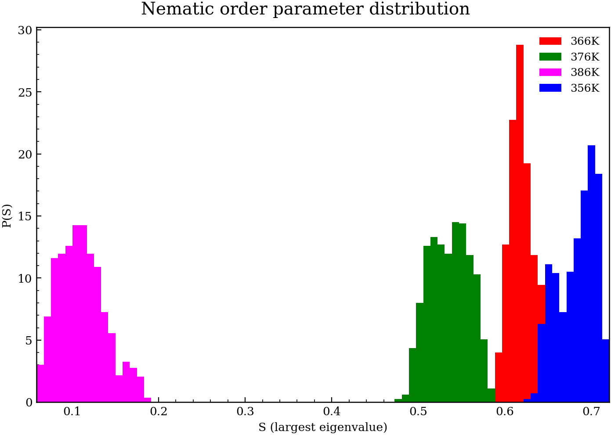
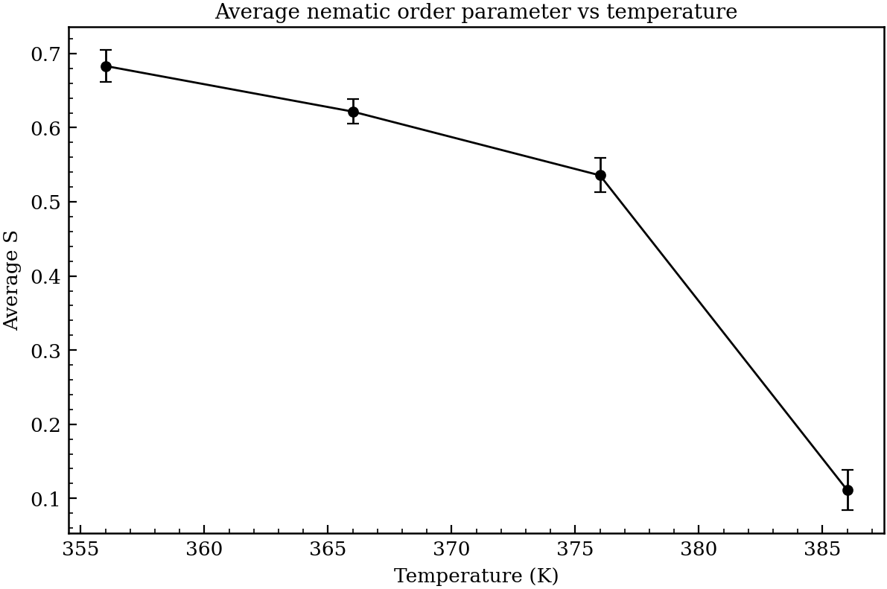

# nematics

Python translation of legacy Fortran analysis for 5CB Gromacs trajectories.

Documentation is available [here](docs/index.md).

## Quick start

```bash
# Create env (requires uv)
uv venv .venv-nematics
source .venv-nematics/bin/activate
uv pip install -e .
```

Run on a single frame:

```bash
nematics paf --gro-dir "data/Poon, Chi-Duen - 5cb-x1000-gaff-88x88x94-zalign/gro" --frame 0
```

Plot P(S) from saved order data:

```bash
uv pip install -e ".[viz]"
python plotting/plot_ps.py
```

Compute and save S for all four trajectories:

```bash
nematics order
```

Recompute order with the `11-feb-2026` CN-dipole director (`ddir`) instead of the
legacy molecular long axis (`molzax`):

```bash
nematics order --axis ddir --out-dir data/order
```

Compute the new `11-feb-2026` Fortran-style pair-correlation histograms for one trajectory:

```bash
# one-time build of fast Fortran backend
nematics build-fortran

nematics paircorr \
  --gro-dir "data/Poon, Chi-Duen - 5cb-x1000-gaff-88x88x94-zalign/gro" \
  --label 356 \
  --out-dir data/paircorr \
  --backend auto \
  --save-every 0
```

`--backend auto` uses Fortran if available (falls back to Python).  
Use `--backend fortran` to force compiled mode.

The generated `.dat` files include:
- `*_5CB_par_1.0.dat`, `*_5CB_par_2.0.dat`, `*_5CB_par_3.0.dat`, `*_5CB_par_all.dat`, `*_5CB_per.dat`, `*_5CB_rad.dat`
- `*_CN_par_1.0.dat`, `*_CN_par_2.0.dat`, `*_CN_par_3.0.dat`, `*_CN_par_all.dat`, `*_CN_per.dat`, `*_CN_rad.dat`

## Example Outputs





If you want to disable progress output:

```bash
python plotting/plot_ps.py --no-progress
```

To reproduce the current report figures from saved order arrays:

```bash
python plotting/plot_ps.py --order-dir data/order
```

To generate pair-correlation analysis figures from `data/paircorr/*.dat`:

```bash
python plotting/plot_paircorr.py --paircorr-dir data/paircorr --out-dir reports/paircorr
```

## Documentation (MkDocs)

Install docs dependencies and serve locally:

```bash
uv pip install -e ".[docs]"
mkdocs serve
```

Then open the local URL printed by MkDocs (usually `http://127.0.0.1:8000`).
