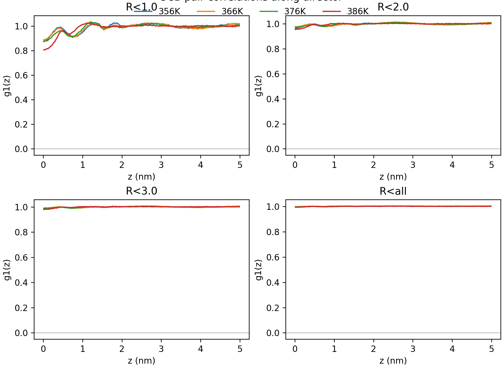
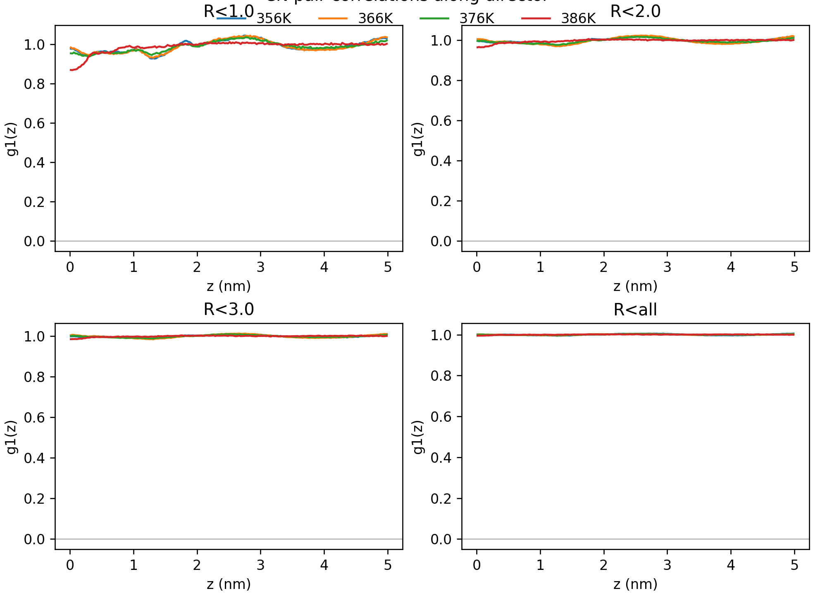
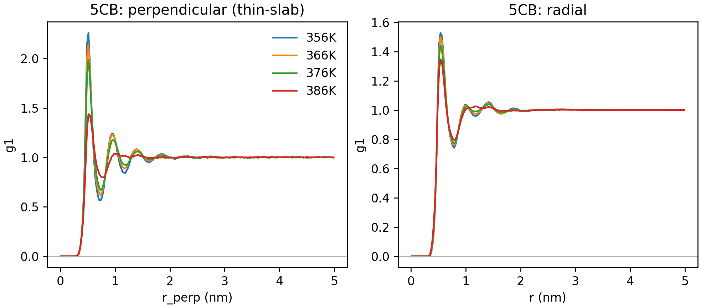
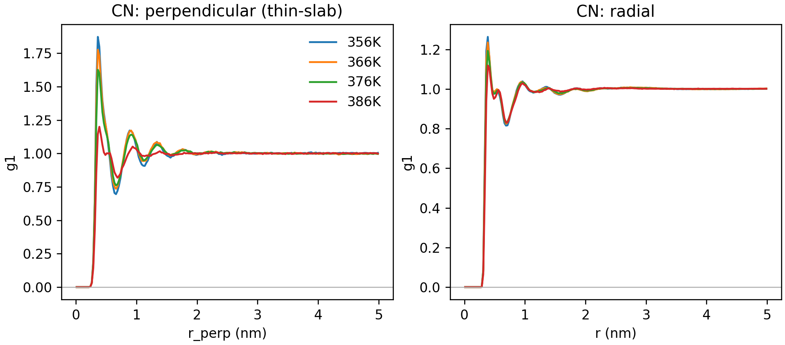
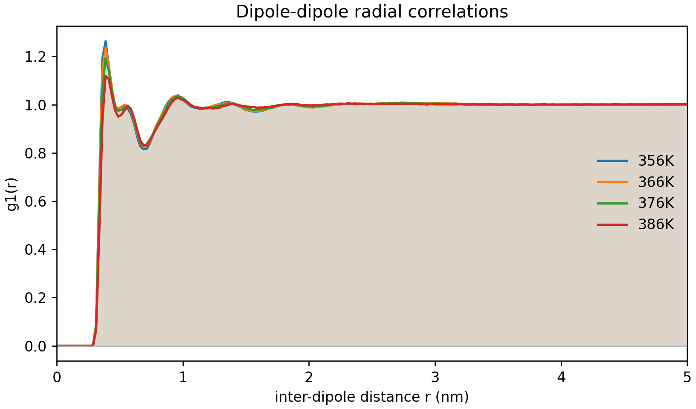

# Math: Pair Correlations

This page documents the pair-correlation expressions used in the report and how they map to `nematics paircorr`.

## Geometry

For a pair $(i,j)$:

- displacement: $\mathbf{r}_{ij} = \mathbf{r}_j - \mathbf{r}_i$
- global director: $\mathbf{Z}$ (largest-eigenvector frame director)
- parallel component: $z_{ij} = \mathbf{r}_{ij}\cdot\mathbf{Z}$
- perpendicular component: $r_{\perp,ij} = \sqrt{\lVert\mathbf{r}_{ij}\rVert^2 - z_{ij}^2}$

Periodic boundary conditions are handled with 27 image shifts $(k_x,k_y,k_z)\in\{-1,0,1\}^3$.

## Correlation-function expressions

### Parallel family (cylindrical selection)

For a cylinder radius $R$:

$$
g_{0,\parallel}(z;R) \propto
\left\langle
\delta\!\left(z-\mathbf{r}_{ij}\!\cdot\!\mathbf{Z}\right)\,
\Theta\!\left(R^2-r_{\perp,ij}^2\right)
\right\rangle_{ij}
$$

Orientational channel (used as $g_1$ in plotting):

$$
g_{1,\parallel}(z;R) \propto
\left\langle
\left(\mathbf{u}_i\!\cdot\!\mathbf{u}_j\right)\,
\delta\!\left(z-\mathbf{r}_{ij}\!\cdot\!\mathbf{Z}\right)\,
\Theta\!\left(R^2-r_{\perp,ij}^2\right)
\right\rangle_{ij}
$$

### Perpendicular family (thin slab around director plane)

For slab half-thickness $d_z$:

$$
g_{0,\perp}(r_\perp;d_z) \propto
\left\langle
\delta\!\left(r_\perp-r_{\perp,ij}\right)\,
\Theta\!\left(d_z-\lvert z_{ij}\rvert\right)
\right\rangle_{ij}
$$

$$
g_{1,\perp}(r_\perp;d_z) \propto
\left\langle
\left(\mathbf{u}_i\!\cdot\!\mathbf{u}_j\right)\,
\delta\!\left(r_\perp-r_{\perp,ij}\right)\,
\Theta\!\left(d_z-\lvert z_{ij}\rvert\right)
\right\rangle_{ij}
$$

### Radial family

$$
r_{ij}=\lVert\mathbf{r}_{ij}\rVert
$$

$$
g_{0,\mathrm{rad}}(r) \propto
\left\langle
\delta\!\left(r-r_{ij}\right)
\right\rangle_{ij},
\qquad
g_{1,\mathrm{rad}}(r) \propto
\left\langle
\left(\mathbf{u}_i\!\cdot\!\mathbf{u}_j\right)\,
\delta\!\left(r-r_{ij}\right)
\right\rangle_{ij}
$$

In code these are discretized in bins and normalized with geometry-dependent factors (`dnz`, `dnr`, `dnr2`).

## Weighted channels (Fortran `WW`)

For each accepted pair, channels are:

$$
\begin{aligned}
W_1 &= 1 \\
W_2 &= \mathbf{u}_i\cdot\mathbf{u}_j \\
W_3 &= (W_2)^2 \\
W_4 &= (\mathbf{u}_i\cdot\mathbf{Z})(\mathbf{u}_j\cdot\mathbf{Z}) \\
W_5 &= (W_4)^2 \\
W_6 &= \mathbf{y}_i\cdot\mathbf{y}_j
\end{aligned}
$$

Species definition:

- `5CB`: $\mathbf{u}$ is molecular long axis (`molzax`)
- `CN`: $\mathbf{u}$ is dipole direction (`ddir`)

## Histogram families written by the code

- `par_1.0`, `par_2.0`, `par_3.0`, `par_all`: bins in $|z|$ with $r_\perp<R$, $R\in\{1,2,3,5\}$ nm
- `per`: bins in $r_\perp$ with $|z|<d_z$, $d_z=0.2$ nm
- `rad`: bins in $r$
- default binning: 200 bins over $[0,5]$ nm

## Output columns in each `.dat` file

- col 0: bin center
- col 1: baseline count channel ($g_0$-like)
- col 2: $W_2$ channel (used as \(g_1\) in current plotting)
- col 3: $W_3$
- col 4: $W_4$
- col 5: $W_5$
- col 6: $W_6$
- col 7..11: reserved (currently zero with `ylen=10`)

## Plot mapping

`plotting/plot_paircorr.py` currently plots **col 2** for all panels, so those curves are the $W_2$ orientational-correlation channel.

## Plots

### 5CB along director

### CN along director

### 5CB perpendicular and radial

### CN perpendicular and radial

### CN dipole radial

