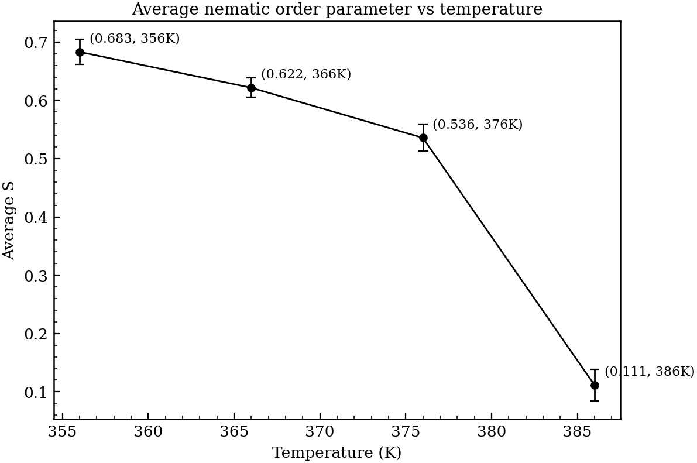
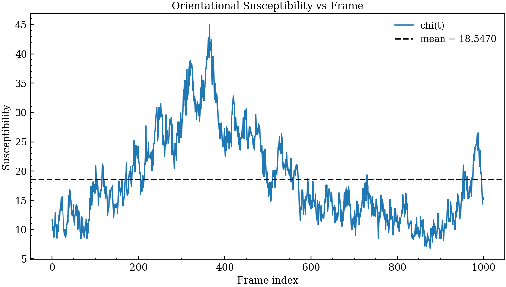
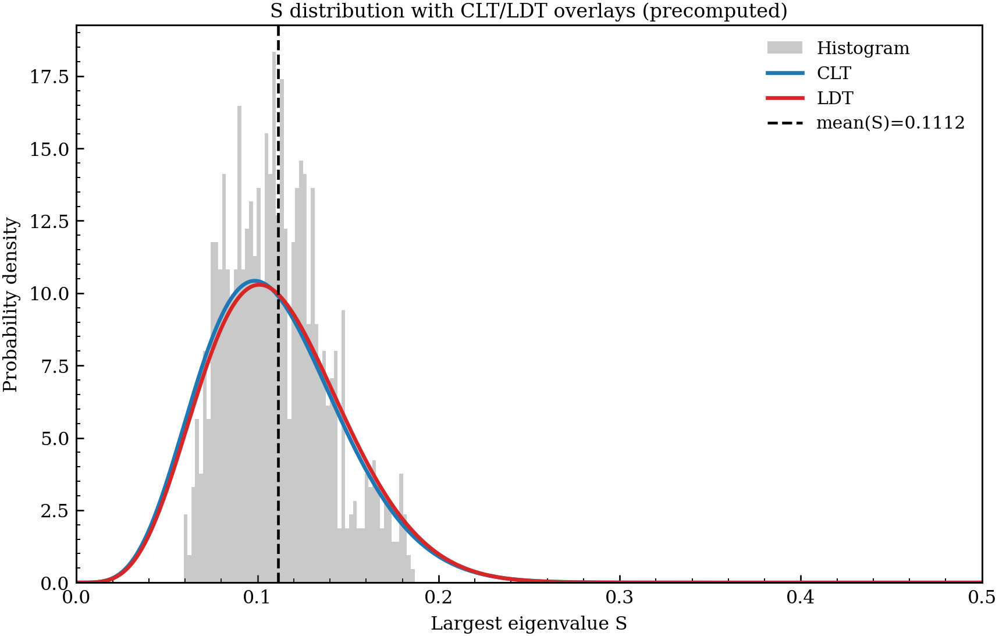

# Results Report

This page summarizes generated analysis outputs as a compact report.

## Dataset and context

- System: 5CB trajectories (`gro`, `gro 2`, `gro 3`, `gro 4`)
- Frames analyzed: 1000 per trajectory
- Isotropic-focused theory analysis: `gro 4` (highest temperature)

## Key summary numbers (gro 4)

- Mean largest eigenvalue: **0.11123**
- Std largest eigenvalue: **0.02722**
- Mean susceptibility: **18.54695**
- Std susceptibility: **7.62422**
- Fitted theory parameter: **$\beta\epsilon = 0.806686$**

## Order parameter results

### Distribution of $S$

### Mean $S$ vs temperature

## Pair-correlation results

### 5CB pair correlations along director

### 5CB perpendicular and radial pair correlations

### CN pair correlations along director

### CN perpendicular and radial pair correlations

### CN dipole-dipole radial correlations

## Susceptibility result

### Time series of susceptibility $\chi(t)$ (gro 4)

## Isotropic fluctuation-theory overlay

Histogram of largest eigenvalue $S$ with central-limit-theory (CLT) and large-deviation-theory (LDT) overlays:

Theory details and equations are documented in:

- `Math -> CLT and LDT for S`

Reference:

Mainas, E., & Stratt, R. M. *Exceptionally large fluctuations in orientational order: The lessons of large-deviation theory for liquid crystalline systems.* Journal of Chemical Physics, 162, 024501 (2025).
